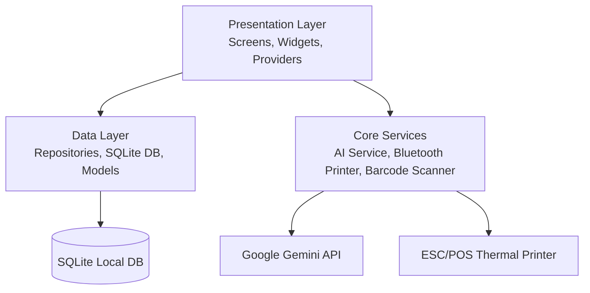

  

<h1 align="center">Book Store POS</h1>

  <strong>A modern, offline-first Point of Sale & Inventory Management System built with Flutter and powered by Google Gemini AI.</strong>

  <em>Developed by Alqa Tech</em>

  
  
  
  
  
  

  

---

## 📌 Overview

**Book Store POS** is a retail solution crafted specifically for bookstores, publishers, and stationery shops. Engineered with an offline-first architecture using **Flutter** and local **SQLite**, it guarantees uninterrupted store operations even without an active internet connection.

It combines daily retail operations — lightning-fast billing, camera barcode scanning, Bluetooth thermal printing, distributor/customer credit ledgers, and inventory controls — with next-generation **Google Gemini Vision AI** that recognizes books and extracts titles in multiple scripts directly from book covers.

> [!IMPORTANT]
> **Portfolio Showcase Notice**: This repository serves as an architectural and technical portfolio showcase demonstrating real-world production Flutter development. It is a commercial application and proprietary codebase.
> 
> 👉 **To purchase licenses or get the full version, visit [bookstorepos.alqatech.in](https://bookstorepos.alqatech.in/).**

---

## ✨ Key Features

### 🛒 Point of Sale & Billing
- **Rapid Checkout Flow**: Instant search by Title, Author, Publisher, or Barcode/ISBN with quick quantity adjustments and item-level/cart-level discounts.
- **Integrated Camera Barcode Scanner**: Snappy in-app camera scanning powered by `mobile_scanner` with custom audio chime and haptic vibration feedback.
- **Multiple Payment Methods**: Support for Cash, UPI / Digital wallets, Split payments, and Customer Credit.
- **Sales Returns & Adjustments**: Smooth return processing linked directly to original invoices with automated stock re-crediting.

### 🤖 AI-Powered Book Cover Extractor (Google Gemini AI)
- **Multimodal Visual Extraction**: Integrates **Google Gemini 2.5 Flash** to capture and analyze book covers using the camera.
- **Native Script & Language Support**: Intelligently extracts non-English scripts (such as Tamil script, Hindi, etc.) in their authentic form without unwanted translations.
- **Instant Cataloging**: Automatically parses titles and attributes directly into the book intake form to save hours of manual typing.

### 📦 Inventory & Catalog Management
- **Rich Book Metadata**: Track books by Title, Author, Publisher, Category, Edition, Language, ISBN, SKU, Cost Price, and Selling Price.
- **Real-Time Stock Tracking**: Automatic stock deductions on sales and increments on purchases and returns.
- **Low Stock Alerts**: Visual badges and filtering for items nearing out-of-stock thresholds.
- **Bulk Excel Operations**: Import and export thousands of catalog records and stock balances using formatted Excel spreadsheets.

### 🖨️ Hardware & Thermal Printing
- **Bluetooth ESC/POS Support**: Connect directly to standard 58mm and 80mm wireless thermal receipt printers (`blue_thermal_printer`, `esc_pos_utils_plus`).
- **Customizable Receipt Layouts**: Store logo, shop name, address, GST/tax details, footer greetings, and QR codes on printed slips.
- **Digital Invoices & PDF Export**: Generate professional vector PDF receipts and invoices for sharing via WhatsApp, email, or system printers.

### 👥 Accounts, Customers & Distributor Ledgers
- **Customer Credit Accounts**: Maintain customer profiles, track credit purchases, record partial settlements, and monitor outstanding balances.
- **Distributor & Supplier Management**: Log purchase orders, manage purchase returns, and track accounts payable balances per supplier.
- **Settlement History**: Complete chronological ledger of payments, credits, and debits with detailed receipts.

### 📊 Business Analytics & Reports
- **Visual Dashboards**: Interactive charts powered by `fl_chart` illustrating daily, weekly, and monthly sales trends.
- **Financial Summaries**: Clear breakdown of revenue, cost of goods sold (COGS), gross profits, and expense summaries.
- **Inventory Valuation**: Total asset value calculation based on cost price and retail value.

---

## 🏗️ Architecture & Tech Stack

The application follows a clean, modular, and maintainable architecture separating core business logic, local persistence, state management, and UI components.

### Core Technologies
| Component | Technology | Description |
| :--- | :--- | :--- |
| **Framework** | [Flutter](https://flutter.dev) (v3.x / Dart 3.5+) | Cross-platform UI toolkit |
| **State Management** | [Provider](https://pub.dev/packages/provider) | Predictable, scalable reactive state handling |
| **Local Database** | [sqflite](https://pub.dev/packages/sqflite) / [sqflite_common_ffi](https://pub.dev/packages/sqflite_common_ffi) | Robust, offline-first relational database |
| **AI Integration** | [google_generative_ai](https://pub.dev/packages/google_generative_ai) | Gemini 2.5 Flash multimodal vision model |
| **Hardware Printing** | [blue_thermal_printer](https://pub.dev/packages/blue_thermal_printer) & [esc_pos_utils_plus](https://pub.dev/packages/esc_pos_utils_plus) | Wireless ESC/POS thermal printing |
| **Document & PDF** | [pdf](https://pub.dev/packages/pdf) & [printing](https://pub.dev/packages/printing) | Printable vector document generation |
| **Barcode Scanning** | [mobile_scanner](https://pub.dev/packages/mobile_scanner) | High-performance camera barcode & QR detection |
| **Charts & Metrics** | [fl_chart](https://pub.dev/packages/fl_chart) | Interactive business charts and analytics |
| **File / Data I/O** | [excel](https://pub.dev/packages/excel), [cunning_document_scanner](https://pub.dev/packages/cunning_document_scanner) | Bulk data import/export & doc scanning |

---

## ⚙️ Configuration Highlights

### 1. Google Gemini AI Setup
The AI book title extractor can be configured directly inside the application settings:
1. Navigate to **Settings** ➔ **AI Configuration**.
2. Enter your Google Gemini API key.
3. Choose your preferred model (`gemini-2.5-flash` or `gemini-2.5-flash-lite`).

### 2. Thermal Printer Pairing
1. Enable Bluetooth on your Android or POS terminal device.
2. Pair your 58mm or 80mm ESC/POS thermal printer.
3. Open **Settings** ➔ **Thermal Printer Settings** inside Book Store POS, select your printer from the discovered device list, and run a test print.

---

## 🔒 Commercial & Proprietary Notice

This project is a **commercial product** developed by **Alqa Tech**.

- All source code, designs, and assets in this repository are proprietary.
- This repository is published strictly for technical showcase and portfolio evaluation purposes.
- Unauthorized reproduction, redistribution, or commercial deployment of this software is strictly prohibited.

### Ready to elevate your bookstore operations?

  

For inquiries, custom enterprise solutions, or support, please visit **[https://bookstorepos.alqatech.in/](https://bookstorepos.alqatech.in/)**.

---

  © 2026 Alqa Tech. All Rights Reserved.

